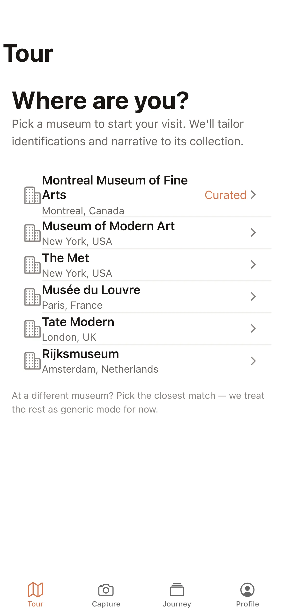
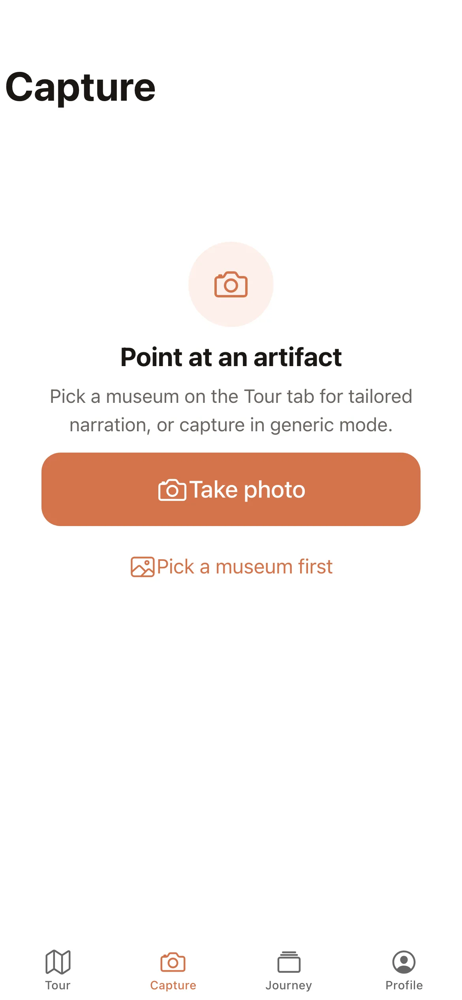

# MyMuseumGuide

**Problem.** A visitor standing at an artifact wants its story in their own language and at their own level of curiosity, and a museum explanation is written once for everyone.

**Idea.** Point the phone at the artifact. The app identifies it, writes a short narrative personalized to the visitor's language, depth level and interests, and reads it aloud so the phone can go back in the pocket.

**Built.** An Ionic, Capacitor and React app with Vercel serverless functions for identify and text-to-speech, Claude through the Vercel AI Gateway, ElevenLabs voices and Supabase for stored narratives. 63 commits on 15 days, Mar 12 to Oct 25, 2026.

**Decision.** Keep the Ionic and Capacitor scaffold and deepen the capture loop, instead of rewriting in Expo/React Native or SwiftUI. The first version (snap, narrate, converse) needs no realtime video, and a rewrite would spend one to two weeks of the sprint reaching parity.

MuseumLover — an AI museum tour-guide mobile app. Point your camera at an artifact and it identifies the piece, generates a narrative, and reads it aloud.



Captured from a local dev run (`VITE_USE_MOCK_AI=true`, mobile viewport).

## What it does

- Capture a photo of an artwork or exhibit (`src/features/capture`, `src/services/camera`)
- Identify the artifact and stream back a narrative via AI (`api/identify.ts`, `api/_lib/identifyCore.ts`, server-sent events in `api/_lib/sse.ts`)
- Narrate the result with text-to-speech (`api/tts.ts`, `api/_lib/elevenlabs.ts`, `api/_lib/ttsCore.ts`), with audio caching (`api/_lib/audioCache.ts`)
- Per-museum theming and a guided tour/journey flow (`src/theme/museumThemes.ts`, `src/features/tour`, `src/features/journey`)
- Persists narratives in Supabase (`api/_lib/narrativesRepo.ts`, `supabase/migrations/0001_narratives.sql`)

## Screenshots



Capture tab, the entry point for identifying an artifact.

## Tech stack

- **Frontend:** React 19 + Ionic React, built with Vite, TypeScript, Tailwind CSS v4
- **Mobile:** Capacitor 8 (camera, geolocation, filesystem, haptics, preferences, share, status bar)
- **State/data:** Zustand, TanStack Query
- **Backend:** Vercel serverless functions (`api/`)
- **AI:** Vercel AI SDK via AI Gateway (`api/_lib/ai.ts`)
- **TTS:** ElevenLabs
- **Database:** Supabase
- **Testing:** Vitest (unit), Cypress (e2e)

## Getting started

```bash
npm install
cp .env.example .env   # fill in the keys below
```

For UI work without any keys, set `VITE_USE_MOCK_AI=true` and run `npm run dev`. Backend provisioning (Supabase, ElevenLabs, AI Gateway, Vercel) is walked through in [`docs/SETUP.md`](docs/SETUP.md).

Environment variables (see `.env.example`):

- Server: `AI_GATEWAY_API_KEY`, `ELEVENLABS_API_KEY`, `SUPABASE_URL`, `SUPABASE_SERVICE_ROLE_KEY`
- Client: `VITE_API_BASE_URL` (empty for same-origin), `VITE_USE_MOCK_AI` (`true` to use the in-app mock instead of `/api`)

Scripts (from `package.json`):

```bash
npm run dev            # Vite dev server (frontend only)
npm run dev:full       # vercel dev — frontend + api functions
npm run build          # tsc && vite build
npm run preview        # preview the production build
npm run test.unit      # vitest
npm run test.e2e       # cypress run
npm run lint           # eslint
npm run typecheck:api  # type-check the api/ functions
npm run preflight      # check the four server credentials against the live services
npm run measure        # latency check for identify + TTS (see docs/SETUP.md)
```

## Project structure

```
api/            Vercel serverless functions (identify, tts) + shared _lib
src/
  features/     capture, tour, journey, onboarding, profile
  services/     ai, audio, camera, identity, storage
  state/        Zustand stores (session, journey, user profile)
  theme/        per-museum themes
  domain/       shared types and models
supabase/       SQL migrations (narratives table, audio bucket)
scripts/        preflight.mjs and measure-latency.mjs
docs/           SETUP.md (backend provisioning)
```

Mobile shell is configured via Capacitor (`capacitor.config.ts`, app id `com.museumlover.app`); the web app deploys to Vercel (`vercel.json`). CI (`.github/workflows/ci.yml`) runs typecheck, lint and unit tests on every push.
